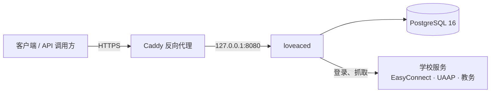

<p align="center">
  
</p>

<h1 align="center">LoveACE Go</h1>

<p align="center">
  安徽财经大学校园服务的 Go 实现：学校连接器、命令行工具与可自托管的后端。
</p>

<p align="center">
  
  
  
</p>

---

## 目录

- [简介](#简介)
- [功能](#功能)
- [架构](#架构)
- [快速开始](#快速开始)
- [自部署教程](#自部署教程)
- [配置参考](#配置参考)
- [接口概览](#接口概览)
- [开发与测试](#开发与测试)
- [安全说明](#安全说明)
- [项目结构](#项目结构)
- [许可证与免责声明](#许可证与免责声明)

## 简介

学校的服务（教务、一卡通、第二课堂、后勤电费、报修等）没有公开的 API。
本项目实现了学校的完整认证链（EasyConnect 网关的 RSA 登录与 UAAP/CAS 认证），
并把 73 项操作的抓取与解析统一成一个操作目录，供命令行和后端共用。

三个组成部分：

1. **`core/`：学校连接器。** 认证链、会话过期自愈、73 项操作。读请求遇到会话过期会恢复并重放一次；
   写请求绝不重放，结果不确定时返回 `outcome_unknown`。
2. **`cmd/loveace`：命令行工具。** `operations`、`call`、`shell`、`self-test`，在终端里直接使用全部能力。
3. **`server/`：loveaced 后端。** 在连接器之上提供账号体系（信封加密的凭据保险库）、Ed25519 访问令牌与刷新轮换、
   读穿缓存、公告、校历、健康监测和管理端点。

## 功能

- 教务：学业概览、学期成绩、考试、培养方案完成度、课表与校历合并视图
- 一卡通：余额、流水、缴费记录
- 第二课堂与劳育：学分、活动、社团、签到
- 后勤：宿舍电费（支付为写操作，需显式授权）
- 报修、竞赛、自动评教（可选，默认关闭）
- 统一错误格式：RFC 9457 `application/problem+json`，带稳定的 `code` 字段

## 架构



- loveaced 只监听 `127.0.0.1:8080`，TLS 由宿主机上的 Caddy 终结；数据库不对外暴露。
- 学校会话为**每个账号一个直连会话**，不做共享池。网关验证码由三段循环处理：自动求解、熔断、人工挑战。
- 学校密码使用 AES-256-GCM 信封加密保存，主密钥（KEK）只来自环境变量。

## 快速开始

### 环境要求

| 用途 | 要求 |
| --- | --- |
| 开发 / 测试 | Go 1.27.3 或更新版本 |
| 生产部署 | Linux x86_64（glibc 系，推荐 Debian 12）、Podman 4+ 与 podman-compose 1.x，或 Docker 与 Compose v2 |
| 公网访问 | 一个域名、开放的 80/443 端口，以及宿主机上的 Caddy 2 |

Alpine（musl）不受支持：验证码求解依赖的 onnxruntime 动态库只能在 glibc 环境加载。

### 本地运行（开发模式）

缺少密钥或数据库时，loveaced 默认拒绝启动。本地一次性运行需要显式开启开发模式：
临时密钥加内存存储，**重启后数据全部丢失，不要用于生产**。

```sh
scripts/fetch_onnxruntime.sh                 # 下载 onnxruntime（测试与镜像构建需要）
LOVEACED_DEV=1 go run ./server/cmd/loveaced  # 监听 :8080，GET /healthz 探活
```

### 命令行工具

```sh
go build -o bin/loveace ./cmd/loveace
./bin/loveace operations                     # 列出 73 项操作
./bin/loveace self-test                      # 离线自检
```

凭据来自标准输入的 JSON、环境变量（`LOVEACE_ACCOUNT`、`LOVEACE_PASSWORD`、`LOVEACE_GATEWAY_PASSWORD`）或交互式提示。
密码从不作为命令行参数传递。写操作（缴费、报名、签到、报修提交、图片上传）默认禁止，需要显式加 `--allow-write`。

## 自部署教程

以下步骤在一台全新的 Linux 服务器上完成一次部署。示例使用 Podman；Docker 用户见第 6、7 步的说明。

### 第 1 步：准备服务器

1. 准备一台 Linux x86_64 服务器，并把域名的 A 记录指向它。
2. 安装 Podman 4+ 与 podman-compose 1.x（或 Docker 与 Compose v2）。
3. 安装 Caddy 2，并确认 80/443 端口可从公网访问。

### 第 2 步：获取源码并下载 onnxruntime

```sh
git clone https://github.com/Sibuxiangx/loveace-go.git
cd loveace-go
scripts/fetch_onnxruntime.sh
```

`scripts/fetch_onnxruntime.sh` 把 onnxruntime 1.22.0 下载到 `third_party/`（已被 gitignore）。
镜像构建会把它打进去，所以**构建前必须先执行这一步**。

### 第 3 步：生成密钥并编辑 `.env`

```sh
cp deploy/.env.example deploy/.env
chmod 600 deploy/.env
```

用 `openssl rand -hex 32` 生成四个**互不相同**的值，分别填入：

| 变量 | 说明 |
| --- | --- |
| `LOVEACED_KEK_HEX` | 凭据保险库主密钥。**丢失后所有已存学校密码无法解密。务必备份到服务器之外**（密码管理器或离线介质）。 |
| `LOVEACED_PEPPER_HEX` | 账号指纹的 HMAC 密钥。丢失只影响指纹匹配，可以重建。 |
| `LOVEACED_JWT_SEED_HEX` | 访问令牌的签名种子。更换会让所有登录失效，但不丢数据。 |
| `LOVEACED_ADMIN_TOKEN` | 管理端点令牌。不设置则 `/v1/admin/*` 整体返回 404。 |

其余变量保持默认即可。按需修改 `LOVEACED_CORS_ORIGINS`（你的前端来源，逗号分隔的精确 origin，留空即不开放跨域）。
`deploy/.env` 已被 gitignore，**不要提交，也不要把它的内容贴进 issue 或聊天**。

### 第 4 步（可选）：启用验证码自动求解

验证码求解需要 ddddocr 项目的 beta 模型 `common.onnx`（约 54 MB）。本仓库不附带模型文件，请自行获取并确认其使用条款。
不启用时，遇到网关验证码会回退为人工挑战，其余功能不受影响。

```sh
sudo mkdir -p /data/captcha/store
sudo chown -R 65534:65534 /data/captcha/store
sudo cp common.onnx /data/captcha/common.onnx
```

然后在 `deploy/.env` 中取消注释并保留：

```sh
LOVEACED_CAPTCHA_MODEL=/data/captcha/common.onnx
LOVEACED_CAPTCHA_STORE=/data/captcha/store
```

并在 `deploy/compose.yml` 的 `loveaced` 服务中取消 `volumes:` 两行的注释。

### 第 5 步：构建镜像

在仓库根目录执行：

```sh
podman build -f deploy/Containerfile -t localhost/loveaced:latest .
```

### 第 6 步：启动数据库与后端

```sh
podman-compose -p loveace -f deploy/compose.yml up -d > /dev/null 2>&1
```

- `-p loveace` 固定项目名。漏掉它，podman-compose 会按目录名另起一套栈，并挂上一个空的数据卷。
- 输出重定向到 `/dev/null`：podman-compose 会把 `podman run` 命令回显到标准输出，其中包含从 `env_file` 读出的密钥。
- 数据库迁移在启动时自动完成。`depends_on` 不等待数据库就绪，启动初期出现几条 `connection refused` 属正常现象。

Docker 用户：`docker build -f deploy/Containerfile -t localhost/loveaced:latest .`，然后 `docker compose -p loveace -f deploy/compose.yml up -d`。

### 第 7 步：验证后端已正常运行

```sh
curl -s http://127.0.0.1:8080/healthz                       # 应输出 ok
podman logs loveace_loveaced_1 2>&1 | grep listening         # 应为 listening on :8080 (dev=false)
```

`dev=false` 表示密钥与数据库都已正确读取。如果日志里出现 `DEV MODE`，检查 `.env` 是否生效。

### 第 8 步：配置 Caddy 反向代理

仓库的 `deploy/caddy/goace.linota.cn` 是站点配置示例。把它复制到 Caddy 的配置目录，并把站点名改成你的域名：

```sh
sudo cp deploy/caddy/goace.linota.cn /etc/caddy/conf.d/api.example.com.conf
sudo vi /etc/caddy/conf.d/api.example.com.conf      # 把 goace.linota.cn 改成你的域名
sudo caddy validate --config /etc/caddy/Caddyfile && sudo systemctl reload caddy
```

如果主 Caddyfile 没有引入该目录，请在其中加入 `import conf.d/*.conf`，或把站点块直接追加到 Caddyfile。
Caddy 会自动申请并续期证书。上游固定为 `127.0.0.1:8080`，与 compose 的端口发布地址一致。

### 第 9 步：上线检查

- [ ] `curl -sI https://你的域名/healthz` 返回 200，证书有效
- [ ] 日志中没有 `DEV MODE`
- [ ] `LOVEACED_ADMIN_TOKEN` 已设置（管理端可用：带令牌请求 `/v1/admin/health` 返回 200，不带令牌返回 401）
- [ ] 已备份 `LOVEACED_KEK_HEX` 到服务器之外
- [ ] 已配置数据库定期备份（见下文）

### 第 10 步：可信代理（使用 WAF 或其他反向代理时必读）

loveaced 只信任来自 `LOVEACED_TRUSTED_PROXIES` 的 `X-Forwarded-For`，默认值为环回地址。
如果日志里所有用户都显示为同一个地址，或者登录限流在多人之间互相影响，说明代理地址没有被识别：

1. 查看日志里 `from` 字段的地址，它就是 loveaced 看到的代理地址。
2. 把该地址或它所在的网段加入 `deploy/.env` 的 `LOVEACED_TRUSTED_PROXIES`（逗号分隔的 CIDR），然后重建容器。

Podman 默认网桥下，容器内看到的宿主机代理地址通常是网桥网关（如 `10.89.0.1`），此时需要加入对应网段（如 `10.89.0.0/24`）。
增加 WAF 时，把 WAF 的出口地址也加入这里，否则所有请求都会被当作来自 WAF。

### 日常运维

**备份数据库**（建议每日定时执行）：

```sh
podman exec loveace_db_1 pg_dump -U loveace loveace | gzip > backup-$(date +%F).sql.gz
```

备份中的凭据已被 KEK 加密，但没有 KEK 就无法使用，因此 KEK 必须单独备份。

**升级**：

```sh
git pull
podman build -f deploy/Containerfile -t localhost/loveaced:latest .
podman rm -f loveace_loveaced_1                 # 必须先删除旧容器
podman-compose -p loveace -f deploy/compose.yml up -d > /dev/null 2>&1
```

podman-compose 不会检测到镜像变化，只执行 `up -d` 会继续运行旧容器。

**回滚**：构建前先给当前镜像打标签，例如 `podman tag localhost/loveaced:latest localhost/loveaced:previous`，回滚时把标签改回并重建容器。
数据库迁移只向前兼容，回滚前先确认新迁移没有删除旧代码依赖的表。

更详细的运维流程（密钥轮换限制、事故处理、数据与隐私）见 [docs/maintenance.md](docs/maintenance.md)。

## 配置参考

| 变量 | 默认值 | 说明 |
| --- | --- | --- |
| `LOVEACED_ADDR` | `:8080` | 监听地址（容器内；compose 只发布到 `127.0.0.1:8080`） |
| `LOVEACED_DATABASE_URL` | 无 | PostgreSQL 连接串（生产必填） |
| `LOVEACED_KEK_HEX` | 无 | 凭据保险库主密钥，32 字节十六进制（生产必填） |
| `LOVEACED_KEK_VERSION` | `v1` | KEK 版本标识（当前不支持在线轮换） |
| `LOVEACED_PEPPER_HEX` | 无 | 账号指纹 HMAC 密钥，32 字节十六进制（生产必填） |
| `LOVEACED_JWT_SEED_HEX` | 无 | Ed25519 令牌签名种子，32 字节十六进制（生产必填） |
| `LOVEACED_DEV` | 未设置 | 设为 `1` 才允许缺密钥或无数据库的临时运行（不要用于生产） |
| `LOVEACED_ADMIN_TOKEN` | 无 | 管理端令牌；未设置时 `/v1/admin/*` 不存在 |
| `LOVEACED_CORS_ORIGINS` | 无 | 允许跨域的精确 origin 列表，逗号分隔 |
| `LOVEACED_TRUSTED_PROXIES` | `127.0.0.1/32,::1/128` | 可信代理的 CIDR 列表，决定采信哪些 `X-Forwarded-For` |
| `LOVEACED_ACCESS_TTL_MINUTES` | `15` | 访问令牌有效期（分钟） |
| `LOVEACED_SESSION_GROUP_SIZE` | `5` | 单账号同时在线的学校会话上限 |
| `LOVEACED_CAPTCHA_MODEL` | 无 | 验证码模型路径；未设置则回退人工挑战 |
| `LOVEACED_CAPTCHA_STORE` | 无 | 验证码判卷结果沉淀目录；未设置则不沉淀 |
| `LOVEACED_TEACHER_EVAL_ENABLED` | 未设置 | 设为 `1` 才开放自动评教 |

## 接口概览

后端的完整接口由运行时的 OpenAPI 文档给出：`GET /openapi.json`。主要分组：

| 分组 | 路径 | 说明 |
| --- | --- | --- |
| 认证 | `POST /v1/auth/sessions` 等 | 登录、令牌刷新、验证码挑战、登出 |
| 账号 | `/v1/me`、`/v1/me/devices` | 账号状态、设备列表与吊销 |
| 教务 | `/v1/me/academic/*` | 学业概览、学期成绩、考试、培养方案、课表（含校历合并视图） |
| 通用操作 | `POST /v1/me/ops` | 73 项操作的统一入口，写操作必须带 `Idempotency-Key` |
| 公开 | `/v1/public/status`、`/v1/public/calendar`、`/v1/public/announcements` | 无需登录 |
| 管理 | `/v1/admin/*` | 需要 `LOVEACED_ADMIN_TOKEN`，只在配置了令牌时存在 |

## 开发与测试

```sh
go vet ./...
go test ./...
go test -race $(go list ./... | grep -v core/captcha)   # core/captcha 与 onnxruntime 的 TSAN 互斥，单独不带 -race 运行
go test ./core/captcha
```

- 测试不需要学校账号，使用模拟传输层与固定的装置数据。
- 含真实账号的实网测试需要自行准备凭据，并遵守学校服务条款。
- 依赖漏洞检查：`go run golang.org/x/vuln/cmd/govulncheck@latest ./...`。

设计原理见 [server/DESIGN.md](server/DESIGN.md)，工程现状与已知限制见 [AGENTS.md](AGENTS.md)。

## 安全说明

- **凭据**：学校密码用 AES-256-GCM 信封加密（每个用户独立的数据加密密钥，AAD 绑定用户），主密钥只来自环境变量。
  日志和错误响应不回显密码。
- **令牌**：访问令牌为 Ed25519 签名，有效期 15 分钟；刷新令牌一次性轮换，重复使用会吊销整台设备的令牌。
  登出后的设备在每个请求上立即失效。
- **启动**：缺密钥或缺数据库时拒绝启动，不会静默降级为临时存储。
- **代理与限流**：客户端地址只在来自可信代理时采信，伪造的 `X-Forwarded-For` 会被忽略。
- **管理端**：未配置令牌时管理端点不存在，而不是开放访问。
- **已知限制**：学校侧的账号冷静期对任何人的错误密码都会生效，可能被用来干扰某个学号（见 DESIGN §5.2）。这是为保护学校账号做出的设计取舍。

发现安全问题请**不要**公开提交 issue，请通过 GitHub 的 Security Advisories 私下报告。

## 项目结构

```text
core/          学校连接器：认证链、会话、73 项操作、解析
cmd/loveace/   命令行工具
server/        loveaced 后端：API、凭据保险库、缓存、验证码求解
deploy/        Containerfile、compose、Caddy 站点示例、.env 模板
docs/          维护手册、前端接入说明、操作参考（docs/ops.md）
scripts/       onnxruntime 下载脚本、凭据录入辅助脚本
assets/        仓库展示资源
```

## 许可证与免责声明

源代码基于 [MIT 许可证](LICENSE) 发布。

项目名称、LoveACE 标志与图标属于品牌资源，**不随 MIT 许可证授权**。如需使用，请先取得作者同意。

本项目是非官方的第三方实现，与安徽财经大学没有隶属关系。它访问的是学校公开提供给学生的网络服务，使用者需自行遵守学校的相关规定与服务条款，并对自己的部署与使用负责。
请勿用于批量抓取、干扰学校服务或其他未经授权的用途。
